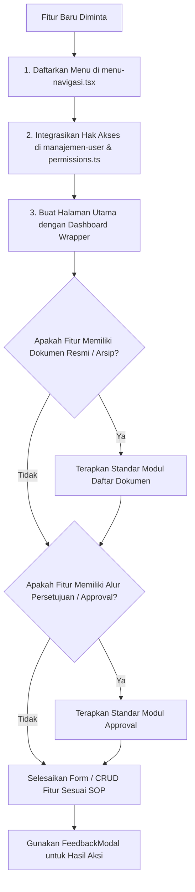

# SPARTA DC-Development — AI Assistant Rules & Development Guidelines

Dokumen ini adalah **pedoman teknis wajib** bagi AI Assistant dalam membangun, memodifikasi, dan mengembangkan fitur-fitur pada ekosistem aplikasi **SPARTA DC-Development**. Semua aturan di bawah ini harus dipatuhi secara konsisten tanpa pengecualian.

---

## 1. Prinsip Utama: Component Reuse First & Ekstraksi Reusable

### A. Wajib Gunakan Komponen yang Ada Terlebih Dahulu (*Component Reuse First*)
- **Dilarang Menduplikasi Komponen**: Sebelum menulis JSX/TSX atau membuat antarmuka halaman baru, AI **WAJIB** memeriksa folder `components/` untuk menemukan komponen yang sudah ada.
- Dilarang membuat komponen baru yang memiliki fungsi, tata letak, atau styling yang sama jika sudah ada komponen yang dapat digunakan.

### B. Aturan Ekstraksi Komponen Baru (*Reusable by Default*)
- **Jika ada kemungkinan sebuah elemen UI digunakan kembali di modul lain atau muncul lebih dari 1 kali**, AI **WAJIB** mengekstraknya menjadi komponen modular yang rapi di folder yang sesuai:
  - `components/ui/`: Untuk kontrol umum / atom UI (form input, combo box, dropdown filter, feedback modal, dsb).
  - `components/<modul>/`: Untuk komponen berulang yang terikat domain spesifik (misal: `components/dokumen/`, `components/approval/`, `components/fungsi-ruang/`, `components/renovasi/`).
- Komponen baru harus fleksibel (*configurable via props*), menggunakan TypeScript interface yang jelas, dan mendukung prop `className` untuk kemudahan kustomisasi.

### C. Konsistensi Standar Desain SPARTA
- **Cards & Container**: Radius `rounded-2xl` (atau `rounded-xl` untuk sub-card), border halus `border-slate-200/80`, shadow tipis `shadow-2xs` atau `shadow-xs`.
- **Aksen Warna Utama**: SPARTA Orange `#E65F2B` (hover `#d04f1f`), biru enterprise untuk link/dokumen, emerald untuk approve/selesai, amber untuk revisi/peringatan, dan rose untuk tolak/error.
- **Tipografi**: Jelas, bersih, badge status uppercase font-bold `text-[10px]` atau `text-[11px]` ber-tracking luas (`tracking-wider`).
- **Latar Belakang Konten**: Background area dashboard `#FAFAFA` atau `bg-slate-50/50`.

---

## 2. Alur Penambahan Fitur Baru (New Feature Workflow)

Ketika diminta membuat fitur atau menu baru, ikuti tahapan berikut secara berurutan:



### Langkah 1: Daftarkan Menu di Navigasi Sidebar & Manajemen User
1. Buka `components/dashboard/menu-navigasi.tsx`:
   - Tambahkan ID menu ke tipe `DcMenuId` (misal: `"inspeksi-dc"`).
   - Tambahkan item menu ke array `dcMenus`:
     ```ts
     {
       id: "inspeksi-dc",
       title: "Inspeksi Bangunan DC",
       href: "/dc-development/inspeksi",
       icon: ClipboardCheck, // dari lucide-react
       group: "Proyek & Transaksi" // Pilihan: "Proyek & Transaksi" | "Master Data" | "Administrator" | "Laporan & Katalog"
     }
     ```
   - *Catatan Penting*: Menu yang didaftarkan di `dcMenus` secara otomatis muncul di formulir hak akses **Manajemen User** (`app/dc-development/manajemen-user/page.tsx` via `AVAILABLE_MENUS`).
   - Sesuaikan logika filtering visibilitas role pada `sidebarGroups` di `menu-navigasi.tsx`.

### Langkah 2: Buat Halaman Utama Fitur
1. Buat direktori halaman `app/dc-development/<nama-fitur>/page.tsx`.
2. Selalu gunakan pembungkus layout utama:
   ```tsx
   import Dashboard from "@/components/dashboard/dashboard";

   export default function NamaFiturPage() {
     return (
       <Dashboard title="Judul Halaman">
         <div className="flex flex-col bg-[#FAFAFA] p-3 md:p-5 lg:p-6 animate-in fade-in duration-300 overflow-y-auto h-[calc(100vh-60px)] space-y-4">
           {/* Konten menggunakan komponen reusable */}
         </div>
       </Dashboard>
     );
   }
   ```

---

## 3. Aturan Khusus: Hak Akses, Kepemilikan & Alur Revisi (Revision & Ownership Rules)

### A. Visibilitas Dokumen Berstatus REVISI (Private to Creator & Admin)
- **Hanya Masuk ke Pembuat Asli (*Creator*)**: Dokumen yang berstatus `REVISI` **HANYA** boleh muncul dan dilihat oleh user pembuat dokumen (`created_by === user.email` atau `isSameCreator(user, created_by)`) serta akun **Administrator** (`isApprovalAdmin`).
- **Dilarang Muncul di Meja Approver Lain**: Pejabat peninjau/approver (seperti BM, Regional BM, DC Specialist, GM, Director) **TIDAK BOLEH** melihat dokumen yang sedang berstatus `REVISI` di antrean maupun daftar berkas mereka, karena berkas tersebut dikembalikan sepenuhnya ke pembuat untuk diperbaiki.

### B. Aturan Tampilan & Aksi pada Tabel Berstatus REVISI
- **Sembunyikan Tombol "Detail" & "Lihat PDF"**: Pada daftar tabel transaksi (misal tabel Menu Fungsi Ruang), tombol aksi **Detail** dan **Lihat PDF** wajib disembunyikan jika baris pengajuan berstatus `REVISI`.
- **Aksi yang Diizinkan saat REVISI**:
  - Tombol **"Perbaiki"**: Mengarahkan pembuat ke halaman edit formulir perbaikan revisi (`/dc-development/<modul>/[id]/edit`).
  - Tombol **"Hapus"**: Mengizinkan pembuat/Admin membatalkan pengajuan yang berstatus revisi. Dokumen yang sedang aktif di alur approval dilarang dihapus.

### C. Aturan Halaman Formulir Edit Revisi (`[id]/edit/page.tsx`)
1. **Dropdown Input**: Pilihan seperti *Jenis Pengajuan* wajib menggunakan ComboBox modern dengan pencarian (`SearchableSelectInput`).
2. **Banner Catatan Revisi**: Wajib menampilkan banner peringatan di bagian atas formulir yang memuat seluruh catatan reviewer terdahulu agar pembuat tahu apa yang harus diperbaiki.
3. **Validasi Wajib Mengubah Minimal 1 Data**:
   - Sistem wajib memvalidasi bahwa pembuat **mengubah minimal satu nilai field** sebelum tombol *"Ajukan Ulang Revisi"* aktif.
   - Dilarang mengizinkan pengajuan ulang revisi jika seluruh data sama persis dengan pengajuan sebelumnya tanpa ada perbaikan.
   - Validasi ini wajib diterapkan di **Client-side** (banner peringatan + disable tombol) dan **Server-side API** (cek payload vs data lama sebelum update status ke approval berikutnya).

---

## 4. Aturan Khusus: Approval Bertingkat & Visibilitas Dokumen (Approval Tiers & Visibility)

### A. Alur Tahapan Persetujuan Berjenjang (Hierarchical Approval Tiers)

1. **Modul Perubahan Fungsi Ruang (PFR) — 7 Tingkat Persetujuan**:
   - `MENUNGGU APPROVAL BM/DBM` (Branch Manager / Deputi BM Cabang)
   - `MENUNGGU APPROVAL GM DEPT PEMOHON` (General Manager Departemen Pemohon)
   - `MENUNGGU APPROVAL REGIONAL B&M MANAGER` (Regional B&M Manager)
   - `MENUNGGU APPROVAL DC SPECIALIST` (DC Building & Development Specialist / Manager)
   - `MENUNGGU APPROVAL B&M GM` (Building & Maintenance General Manager)
   - `MENUNGGU APPROVAL DIRECTOR DEPT PEMOHON` (Direktur Departemen Pemohon)
   - `MENUNGGU APPROVAL PROPERTY & DEV DIRECTOR` (Property & Development Director)
   - `APPROVED` (Disetujui Final / Selesai)

2. **Modul Penawaran RAB / OE — 4 Tingkat Persetujuan**:
   - `MENUNGGU APPROVAL BM/DBM`
   - `MENUNGGU APPROVAL REGIONAL B&M MANAGER`
   - `MENUNGGU APPROVAL DC SPECIALIST`
   - `MENUNGGU APPROVAL B&M GM`
   - `APPROVED` (Disetujui Final / Selesai)

### B. Aturan Visibilitas Bertingkat (*Tiered Visibility*)
- **Tab "Perlu Tindakan Saya"**: HANYA memunculkan dokumen yang status persetujuannya berada tepat pada giliran peran pengguna yang login (misal: saat status `MENUNGGU APPROVAL BM/DBM`, hanya BM/DBM yang melihat antrean ini).
- **Tab "Semua Berkas Terkait"**: Approver pada tingkat tertentu hanya dapat memantau berkas yang statusnya sudah melewati atau berada pada tingkatannya (misal: Regional BM baru dapat melihat berkas setelah lolos dari BM/DBM). Dokumen yang masih berada di tingkat sebelum wewenangnya tidak boleh terlihat.
- **Maker (Pembuat Pengajuan)**: Hanya berhak melihat pengajuan yang dibuat oleh dirinya sendiri (`created_by === user.email`), ditambah pengajuan berstatus final `APPROVED`.
- **Administrator**: Memiliki hak visibilitas penuh terhadap seluruh siklus status pengajuan (`ALL`).

### C. Pembatasan Cakupan Cabang (*Branch Coverage Rule*)
- Seluruh query database dan tampilan UI wajib memvalidasi wewenang cabang user (`coverage_cabang`):
  - Menggunakan utilitas `getUserCoverageBranches(user)` dan `isBranchAccessible(itemBranch, userCoverage)`.
  - Filter cabang pada toolbar wajib menggunakan `BranchFilterSelect` yang otomatis mengecualikan cabang di luar wewenang pengguna (kecuali Admin/Direksi dengan cakupan nasional).

---

## 5. Aturan Khusus: Pembaruan Berkas Resmi & Sinkronisasi PDF

### A. Regenerasi PDF Real-Time saat Aksi Approval
- Setiap kali terjadi aksi **APPROVE** atau **REVISI**:
  - Berkas PDF resmi harus segera di-generate ulang / diperbarui datanya secara real-time.
  - **Status Badge Dinamis**: Status di lembar PDF wajib mengikuti status terbaru (APPROVED, MENUNGGU APPROVAL..., atau REVISI).
  - **Kotak Catatan Revisi**: Jika dokumen berstatus `REVISI`, lembar PDF wajib mencetak kotak instruksi khusus berisi catatan revisi dari reviewer.
  - **Tanda Tangan Digital**: Kolom paraf/tanda tangan pejabat approver wajib mencetak nama lengkap pejabat dan tanggal persetujuan aktual dari audit log.
  - **Matriks Tanda Tangan 9 Kolom & Label Dinamis Departemen**: Matriks tanda tangan PDF Perubahan Fungsi Ruang tersusun atas 9 kolom terkelompok:
    - **DIBUAT** (1 Kolom): Pemohon (Koordinator)
    - **MENGETAHUI** (6 Kolom): Branch B&M Manager, Branch Manager / DBM, **GM Departemen Pemohon (dinamis, misal: GM Finance)**, Regional B&M Manager, DC Specialist, B&M General Manager.
    - **MENYETUJUI** (2 Kolom): **Direktur Departemen Pemohon (dinamis menggantikan Operation Director, misal: Direktur Finance)**, Property Dev Manager.

### B. Sinkronisasi Asinkron (Background Upload)
- Proses sinkronisasi atau pengunggahan file PDF ke Google Drive / Cloud Storage eksternal **WAJIB dijalankan secara background (*asynchronous*)**.
- Respon API approval ke antarmuka pengguna tidak boleh menunggu proses upload Google Drive selesai, sehingga user langsung menerima respon feedback modal tanpa lag/timeout.

---

## 6. Aturan Khusus: Integritas Database Prisma & Foreign Keys

### A. Wajib Menerapkan Cascade Constraint (`CASCADE`)
- Seluruh relasi foreign key pada tabel relasional (seperti `dc_project`, `dc_renovasi`, `dc_fungsi_ruang`, `dc_renovasi_dokumen`, `dc_renovasi_item`, `dc_fungsi_ruang_audit_log`, `dc_approval_audit_log`) **WAJIB** menerapkan:
  ```prisma
  onDelete: Cascade
  onUpdate: Cascade
  ```
- **Tujuan**: Mencegah data *orphaned* (data anak tertinggal tanpa induk) dan menjamin integritas referensial jika data proyek atau pengajuan dihapus/diperbarui.
- *Pengecualian*: Relasi historis master (seperti `master_item_id` pada item RAB) diperbolehkan menggunakan `SetNull` agar jejak historis penawaran tidak hilang jika master harga dihapus.

---

## 7. Panduan Sub-fitur: "Daftar Dokumen" (Katalog Dokumen Resmi)

Jika fitur baru menghasilkan dokumen cetak / PDF resmi, wajib diintegrasikan ke modul Daftar Dokumen:

### A. Daftarkan di Hub Daftar Dokumen (`app/dc-development/daftar-dokumen/page.tsx`)
Tambahkan kartu modul pada array `documentCards` menggunakan komponen `HubCategoryCard`:
```tsx
{
  id: "nama-dokumen",
  title: "Judul Lengkap Dokumen",
  description: "Penjelasan ringkas fungsi dokumen dan referensi SOP resmi.",
  href: "/dc-development/daftar-dokumen/nama-dokumen",
  icon: FileSpreadsheet,
  active: true,
  badge: "Tersedia & Aktif",
  badgeVariant: "success",
  stats: "SOP SAT/SOP/XXX/001",
  actionLabel: "Buka Dokumen",
}
```

### B. Buat Halaman Katalog Dokumen (`app/dc-development/daftar-dokumen/<slug>/page.tsx`)
1. **Banner Header**: Gunakan `DokumenHeaderCard` (`components/dokumen/DokumenHeaderCard.tsx`).
2. **Toolbar Filter & Search**: Gunakan `DokumenFilterToolbar` (`components/dokumen/DokumenFilterToolbar.tsx`) dengan `BranchFilterSelect` dan filter status bertingkat.
3. **Tabel Katalog Dokumen**: Gunakan tabel katalog di `components/dokumen/` (contoh: `Dokumen<NamaFitur>Table.tsx`).
4. **Modal Detail**: Buka `Detail<NamaFitur>Modal` yang menyertakan informasi teknis, `SubmissionReasonCard`, `ApprovalNotesHistory` (collapsible, default tertutup), dan aksi unduh PDF.

---

## 8. Panduan Sub-fitur: "Approval Dokumen" (Persetujuan Berjenjang)

Jika dokumen memerlukan persetujuan bertingkat dari pejabat berwenang:

### A. Daftarkan di Hub Approval (`app/dc-development/approval/page.tsx`)
Tambahkan kartu modul pada array `approvalCards` menggunakan `HubCategoryCard`:
- Berikan badge counter oranye berdenyut jika terdapat antrean: `badge: `${pendingCount} Perlu Tindakan Saya``.
- Aksi: `actionLabel: "Buka Antrean"`.

### B. Buat Halaman Antrean Approval (`app/dc-development/approval/<slug>/page.tsx`)
1. **Header Antrean**: Gunakan `ApprovalPageTitle` (`components/approval/ApprovalPageTitle.tsx`).
2. **Filter & Tabs**: Gunakan `ApprovalFilterToolbar` (`components/approval/ApprovalFilterToolbar.tsx`) dengan tabs `Perlu Tindakan Saya` & `Semua Berkas Terkait`.
3. **Wajib Memasang `FeedbackModal`**: Memberikan notifikasi pop-up grafis sukses/gagal aksi persetujuan tanpa reload halaman.

### C. Modal Peninjauan & Eksekusi Approval (`Review<NamaFitur>Modal.tsx`)
1. **`ApprovalStepper`**: Visualisasi progres alur tahapan approval.
2. **Rincian Data Pengajuan**: Objek teknis yang diajukan maker.
3. **`SubmissionReasonCard`**: Alasan awal pengajuan maker (otomatis tersembunyi jika kosong).
4. **`ApprovalNotesHistory`**: Riwayat persetujuan & catatan peninjau (**collapsible / bisa buka-tutup, default tertutup / `defaultOpen = false`**).
5. **`ApprovalActionCard`**: Ringkasan wewenang approver dan tombol pemicu dialog.
6. **`ApprovalActionDialog`**: Pop-up konfirmasi aksi:
   - **Catatan Wajib Diisi saat Kembalikan Revisi**.
   - **Catatan Opsional saat Setujui (Approve)**.
7. **Pemicu `FeedbackModal`**: Tutup dialog dan tampilkan modal feedback pop-up sukses.

---

## 9. Katalog Komponen Reusable SPARTA (Wajib Dicek Sebelum Buat UI)

| Kategori | Komponen | Lokasi File | Deskripsi & Kapan Digunakan |
| :--- | :--- | :--- | :--- |
| **Layout & Nav** | `Dashboard` | `components/dashboard/dashboard.tsx` | Layout wrapper utama (sidebar navigasi + header bar). Wajib untuk setiap page. |
| **Layout & Nav** | `MenuNavigasi` | `components/dashboard/menu-navigasi.tsx` | Sidebar navigasi & registrasi daftar menu sistem (`dcMenus`). |
| **Hub / Modul Depan** | `HubHeaderBanner` | `components/hub/HubHeaderBanner.tsx` | Banner putih atas untuk halaman hub kategori (Daftar Dokumen Hub, Approval Hub). |
| **Hub / Modul Depan** | `HubCategoryCard` | `components/hub/HubCategoryCard.tsx` | Kartu grid modul dengan ikon oranye squircle, counter pulse, badge status, dan tombol aksi. |
| **Approval** | `ApprovalPageTitle` | `components/approval/ApprovalPageTitle.tsx` | Header antrean approval (tombol kembali, breadcrumb uppercase, badge SOP). |
| **Approval** | `ApprovalFilterToolbar`| `components/approval/ApprovalFilterToolbar.tsx` | Toolbar antrean approval (tabs role queue, status filter admin, search, cabang). |
| **Approval** | `ApprovalActionCard` | `components/approval/ApprovalActionCard.tsx` | Kartu ringkasan wewenang approver dan tombol pemicu dialog persetujuan. |
| **Approval** | `ApprovalActionDialog`| `components/approval/ApprovalActionDialog.tsx` | Pop-up dialog konfirmasi (Setujui / Revisi / Tolak). Revisi catatan wajib diisi. |
| **Approval** | `ApprovalStepper` | `components/approval/ApprovalStepper.tsx` | Visualisasi tahapan approval berjenjang (4 tahap RAB/OE, 7 tahap Fungsi Ruang). |
| **Approval** | `ApprovalNotesHistory`| `components/approval/ApprovalNotesHistory.tsx` | Riwayat persetujuan & catatan peninjau interaktif (bisa buka-tutup / collapsible, default closed). |
| **Approval** | `SubmissionReasonCard`| `components/approval/SubmissionReasonCard.tsx` | Penampil alasan pengajuan awal maker (otomatis disembunyikan jika kosong). |
| **Approval** | `RevisionInstructionBanner` | `components/approval/` | Banner instruksi perbaikan revisi pada form pengajuan ulang maker. |
| **Approval** | `RevisionPinpointBadge` | `components/approval/` | Badge penanda field yang ditandai wajib direvisi oleh reviewer. |
| **Daftar Dokumen** | `DokumenHeaderCard` | `components/dokumen/DokumenHeaderCard.tsx` | Banner header katalog arsip dokumen (ikon + kategori kecil + badge SOP). |
| **Daftar Dokumen** | `DokumenFilterToolbar`| `components/dokumen/DokumenFilterToolbar.tsx` | Toolbar filter katalog dokumen (search bar, filter cabang, filter status, refresh). |
| **Daftar Dokumen** | `DokumenRabOeTable` | `components/dokumen/DokumenRabOeTable.tsx` | Tabel katalog arsip dokumen RAB/OE lengkap dengan aksi detail & unduh PDF. |
| **Daftar Dokumen** | `DokumenFungsiRuangTable`| `components/dokumen/DokumenFungsiRuangTable.tsx` | Tabel katalog arsip dokumen PFR lengkap dengan aksi detail & unduh PDF. |
| **UI Form & Filter** | `BranchFilterSelect` | `components/ui/branch-filter-select.tsx` | Dropdown cabang yang otomatis dibatasi sesuai hak akses `coverage_cabang` user. |
| **UI Form & Filter** | `FilterSelect` | `components/ui/filter-select.tsx` | Dropdown filter bersih modern dengan fitur pencarian dan navigasi keyboard. |
| **UI Form & Filter** | `SearchableSelectInput`| `components/ui/searchable-select.tsx` | ComboBox / Select dengan filter pencarian instan (cocok untuk dropdown jenis form). |
| **UI Form & Filter** | `MultiSelectInput` | `components/ui/multi-select.tsx` | Kontrol multi-select dengan pill badges (digunakan pada hak akses menu user). |
| **UI Dialog & Feedback** | `FeedbackModal` | `components/ui/feedback-modal.tsx` | Modal pop-up visual hasil aksi (sukses atau error) dengan animasi centang/silang. |
| **Modal Detail** | `DetailRenovasiModal` | `components/renovasi/DetailRenovasiModal.tsx` | Modal peninjauan detail lengkap Penawaran RAB/OE, spesifikasi, dan histori. |
| **Modal Detail** | `DetailFungsiRuangModal` | `components/fungsi-ruang/DetailFungsiRuangModal.tsx`| Modal peninjauan detail & eksekusi approval PFR (`showApprovalActions`), komparasi luas, dan histori. |
| **Modal Detail** | `DetailTenderModal` | `components/tender/DetailTenderModal.tsx`| Modal peninjauan detail & eksekusi approval Proposal Tender (`showApprovalActions`), pagu, dan rekanan. |

---

## 10. Checklist Evaluasi Sebelum Menyelesaikan Tugas (Definition of Done)

Sebelum menyatakan sebuah fitur atau perubahan selesai, AI Assistant wajib memverifikasi poin-poin berikut:
- [ ] **Component Check**: Tidak ada duplikasi komponen; seluruh elemen yang dapat dipakai ulang telah memanfaatkan katalog di atas atau diekstrak ke folder `components/`.
- [ ] **Navigasi Terdaftar**: Jika menu baru dibuat, pastikan sudah terdaftar di `dcMenus` pada `menu-navigasi.tsx` dan terbaca di Manajemen User.
- [ ] **Aturan Revisi**: Berkas `REVISI` hanya dapat dilihat oleh pembuat (`created_by === user.email`) dan Admin. Tombol Detail dan Lihat PDF disembunyikan saat status REVISI. Edit revisi wajib mengubah minimal 1 data.
- [ ] **Visibilitas Bertingkat & Coverage**: Data disaring berdasarkan tahapan wewenang role approver dan coverage cabang pengguna (`coverage_cabang`).
- [ ] **Dokumen & Approval**: Jika ada berkas resmi, sudah terdaftar di `Daftar Dokumen`. Jika butuh persetujuan, sudah terdaftar di `Approval` dengan alur validasi catatan revisi wajib.
- [ ] **Feedback Modal**: Setiap aksi persetujuan, revisi, atau penyimpanan form telah menggunakan `FeedbackModal` untuk pengalaman pengguna yang responsif.
- [ ] **Buka-Tutup Riwayat**: Komponen `ApprovalNotesHistory` menggunakan kemampuan collapsible dengan default tertutup (`defaultOpen = false`).
- [ ] **PDF & Database**: Berkas PDF mencetak status & nama approver dinamis (sync Google Drive di background). Relasi Prisma menggunakan `CASCADE`.
- [ ] **Kompilasi TypeScript**: Kode bersih tanpa syntax/type error (`npx tsc --noEmit` valid).

